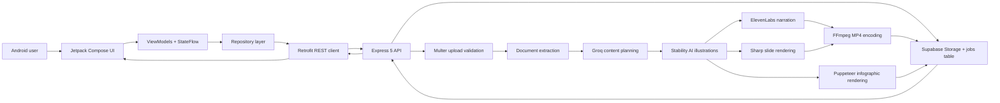

# SeeTrain

SeeTrain is an Android application that turns PDF, DOC, DOCX, and text training documents into polished learning materials. A Kotlin Jetpack Compose client sends the source document to an Express backend; the backend extracts and organizes the content, then generates a narrated MP4 video and an infographic.

The generated video and infographic are stored in Supabase, while job status and history are retrieved through REST APIs from the Android app.

## Table of Contents

- [Project Showcase](#project-showcase)
- [Architecture Overview](#architecture-overview)
- [Components](#components)
  - [Android application](#android-application)
  - [Backend service](#backend-service)
  - [Data and storage](#data-and-storage)
- [Processing Flow](#processing-flow)
- [AI Tools and Services](#ai-tools-and-services)
- [Repository Structure](#repository-structure)
- [Android Setup](#android-setup)
  - [Requirements](#requirements)
  - [Run the Android app](#run-the-android-app)
- [Backend Setup](#backend-setup)
  - [Install and run](#install-and-run)
- [Supabase Setup](#supabase-setup)
- [Backend API](#backend-api)
- [Technical Decisions](#technical-decisions)
- [Challenges Encountered](#challenges-encountered)
- [Future Improvements](#future-improvements)
- [Security Notes](#security-notes)
- [License](#license)

## Project Showcase

| Experience         | Description                                                                  |
| ------------------ | ---------------------------------------------------------------------------- |
| Document upload    | Choose a supported document from the Android Storage Access Framework picker |
| AI lesson planning | Convert source text into concise, structured training sections               |
| AI illustrations   | Generate visuals for each section                                            |
| Training video     | Add narration and section titles, then encode the final MP4                  |
| Infographic        | Render a portrait PNG from the same training content                         |
| Job progress       | Show processing stages while Android polls for updates                       |
| History            | Review completed materials and reopen or download their outputs              |
| Result viewer      | Preview videos and infographics in full-screen dialogs                       |

## Architecture Overview

SeeTrain uses a two-layer architecture with a native Android client and an Express backend:

- **Android client:** Jetpack Compose screens invoke ViewModels, repositories convert UI actions into Retrofit requests, and Media3 plus Android DownloadManager handle playback and downloads.
- **Backend API:** Express validates uploads, persists jobs, extracts document text, plans training content, generates media, and stores results in Supabase.
- **Processing model:** Upload requests return HTTP `202 Accepted`; document extraction and media generation continue asynchronously while the Android app polls job status.
- **External AI services:** Groq plans the lesson structure, Stability AI produces illustrations, and ElevenLabs generates narration.
- **Local media generation:** Sharp renders slide overlays, Puppeteer exports the infographic, and FFmpeg combines narration with slides into the final MP4.
- **Data and media storage:** Supabase stores job metadata and original/generated files. Job responses expose short-lived signed URLs for the Android client.



## Components

### Android application

The `Seetrain` module is a native Android application built with:

- Kotlin 2.2
- Jetpack Compose Material 3
- Android Material components
- Navigation Compose
- Lifecycle ViewModels and StateFlow
- Retrofit and Gson
- OkHttp
- Coil 3 for image loading
- Media3 ExoPlayer for video playback
- Android DownloadManager for file downloads
- Coroutines

Main app features:

- Select PDF, DOC, DOCX, or TXT files
- Upload through multipart HTTP requests
- Poll the backend every three seconds until a job succeeds or fails
- Display a processing overlay while generation is running
- Preview and download the generated MP4
- Preview and download the generated PNG
- Browse globally completed jobs through the history screen

### Backend service

The `Seetrain_BE` module is an Express CommonJS service responsible for:

- Upload validation and document storage
- PDF, DOC, DOCX, and text extraction
- AI training-content planning
- Job status persistence
- Illustration, narration, video, and infographic generation
- Supabase uploads and signed URL delivery
- Job history lookup

The backend accepts documents up to 20 MB and returns HTTP `202 Accepted` with a UUID after creating a job.

### Data and storage

Supabase provides:

- The `jobs` database table
- The private `seetrain-files` storage bucket
- Original document storage
- Generated MP4 storage
- Generated PNG storage
- One-hour signed URLs for client access

## Processing Flow

1. The user selects a document in the Android app.
2. Android reads the document metadata and bytes, then sends it as multipart form data.
3. Multer validates the format and size.
4. The backend creates a Supabase job and stores the original file.
5. The document extractor converts the source into plain text.
6. Groq plans exactly 3 or 4 educational sections with headings, key points, narration, and visual concepts.
7. Stability AI creates an illustration for every section.
8. ElevenLabs creates narration audio for each section.
9. Sharp renders slide content while FFmpeg joins narrated sections into one MP4.
10. Puppeteer renders the infographic HTML and exports it as PNG.
11. The backend uploads both generated files and marks the job `completed`.
12. Android receives one-hour signed URLs, displays the result, and can download the media.

## AI Tools and Services

| Service      | Project usage                                                                              |
| ------------ | ------------------------------------------------------------------------------------------ |
| Groq         | Creates strict, structured training content from extracted text using `openai/gpt-oss-20b` |
| Stability AI | Generates educational illustrations for video slides and the infographic                   |
| ElevenLabs   | Generates section narration audio                                                          |
| FFmpeg       | Combines narration and slide content into the final MP4                                    |
| Sharp        | Resizes images and composites titles and key points                                        |
| Puppeteer    | Renders infographic HTML in Chromium and exports PNG                                       |

The main upload pipeline uses Groq, Stability AI, ElevenLabs, FFmpeg, Sharp, and Puppeteer.

## Repository Structure

```text
Seetrain_App/
├── Seetrain/                  # Android application
│   ├── app/src/main/java/
│   │   └── org/katoridao/seetrain/
│   │       ├── data/          # Models, Retrofit APIs, repositories
│   │       ├── navigation/    # Compose navigation
│   │       ├── screens/       # Home, history, and result screens
│   │       ├── ui/            # Theme and reusable media components
│   │       ├── utils/         # Android download helpers
│   │       └── viewmodel/     # Upload and history state management
│   └── app/build.gradle.kts
│
├── Seetrain_BE/               # Express backend
│   ├── src/
│   │   ├── config/            # Supabase configuration
│   │   ├── routes/            # HTTP routes
│   │   └── services/          # Extraction, generation, and storage services
│   └── package.json
│
└── README.md                  # Project-wide showcase documentation
```

## Android Setup

### Requirements

- Android Studio with current Android SDK support
- JDK 11 or later
- Android emulator or physical device with API 30+
- The backend running and reachable from the device

### Run the Android app

```bash
cd Seetrain
```

Open the `Seetrain` folder in Android Studio, sync Gradle, select a device, and run the app.

The REST base URL is currently configured in:

```text
Seetrain/app/src/main/java/org/katoridao/seetrain/data/remote/RetrofitClient.kt
```

Before running on a physical device, replace the current LAN IP with the backend machine's reachable IPv4 address:

```kotlin
private const val BASE_URL = "http://YOUR_BACKEND_IP:3000/"
```

The app also permits cleartext HTTP because the current local development configuration uses it. Production builds should use HTTPS.

## Backend Setup

### Requirements

- Node.js 20 or later recommended
- npm
- Supabase project
- API credentials for Groq, Stability AI, and ElevenLabs

### Install and run

```bash
cd Seetrain_BE
npm install
npm start
```

For auto-restart development:

```bash
npm run dev
```

The backend listens on port `3000` by default. Create a `.env` file based on the following variable names:

```env
PORT=3000
SUPABASE_URL=https://your-project.supabase.co
SUPABASE_SECRET_KEY=your-server-side-key
GROQ_API_KEY=your-groq-key
STABILITY_API_KEY=your-stability-key
ELEVENLABS_API_KEY=your-elevenlabs-key
ELEVENLABS_VOICE_ID=your-elevenlabs-voice-id
ELEVENLABS_MODEL_ID=eleven_multilingual_v2
```

Never commit real values or expose server secrets in the Android application.

## Supabase Setup

Create:

- A private storage bucket named `seetrain-files`
- A `jobs` table with job status, messages, document metadata, extracted text, and output paths

Expected object layout:

```text
documents/<jobId>/<unique-document-name>.<extension>
videos/<jobId>/training.mp4
infographics/<jobId>.png
```

Configure server-side storage access and database permissions separately. The API generates signed URLs lasting one hour for private media delivery.

## Backend API

| Method | Endpoint         | Purpose                                   |
| ------ | ---------------- | ----------------------------------------- |
| `GET`  | `/health`        | Health check                              |
| `GET`  | `/test-supabase` | Verify Supabase database access           |
| `POST` | `/upload`        | Upload a document and create an async job |
| `GET`  | `/jobs/:id`      | Retrieve status and signed result URLs    |
| `GET`  | `/history`       | Retrieve completed jobs                   |

Example upload:

```bash
curl -X POST http://localhost:3000/upload \
  -F "file=@training-document.pdf"
```

## Technical Decisions

- **Jetpack Compose and Material 3** provide a consistent native Android interface with declarative UI and edge-to-edge support.
- **MVVM plus StateFlow** keeps asynchronous upload and polling state separate from Compose screens.
- **Repository abstractions** isolate Android network calls and document URI access.
- **Supabase** combines persistent job state with private generated-file storage.
- **Strict JSON planning** makes AI output predictable and reduces downstream parsing failures.
- **Shared illustrations** prevent duplicate visual generation between the video and infographic.
- **Private storage and signed URLs** expose generated output only for a limited duration.
- **Asynchronous upload handling** returns quickly instead of blocking the HTTP connection during media generation.
- **FFmpeg and Puppeteer** provide a deterministic local media-generation pipeline without additional rendering microservices.
- **Poll-based status updates** match the current lightweight architecture and avoid adding a real-time transport dependency.

## Challenges Encountered

- AI models may return invalid JSON or inconsistent content.
- AI-generated illustrations may not accurately match the document content.
- External AI APIs may experience timeouts, rate limits, or credit limitations.
- Coordinating multiple AI services into one reliable generation pipeline is challenging.
- Synchronizing narration, images, and text while keeping the video under five minutes.
- Supabase signed URLs may expire while users are viewing generated results.

## Future Improvements

- Implement user authentication and user-specific generation history.
- Deploy the backend with HTTPS and a configurable API URL.
- Improve AI-generated content and illustrations for better accuracy and consistency.
- Add subtitles, animations, and more video customization options.
- Optimize media generation to reduce processing time and resource usage.

## Security Notes

- Keep API keys and Supabase server credentials in `.env` only.
- Do not place Supabase service credentials or AI keys in Android resources.
- Do not commit generated uploads, credentials, service account files, or local media.
