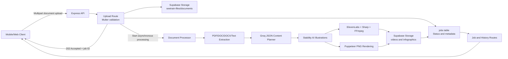

# SeeTrain Backend

SeeTrain Backend is an Express-based service that converts uploaded training documents into structured learning content, a narrated MP4 training video, and a PNG infographic.

The service accepts PDF, DOC, DOCX, and plain-text files, extracts their text, asks an AI model to organize it into a short training program, generates illustrations and narration, and stores both the source document and generated outputs in Supabase Storage.

## Table of Contents

- [Architecture Overview](#architecture-overview)
- [Technology Stack](#technology-stack)
- [Processing Pipeline](#processing-pipeline)
- [API Endpoints](#api-endpoints)
- [Supabase Setup](#supabase-setup)
- [AI Tools or Services Used](#ai-tools-or-services-used)
- [Getting Started](#getting-started)
- [Technical Decisions](#technical-decisions)
- [Challenges Encountered](#challenges-encountered)
- [Future Improvements](#future-improvements)
- [Security Notes](#security-notes)

## Architecture Overview



The backend follows a route-service-storage structure:

- `src/routes` handles HTTP validation and responses.
- `src/services` contains extraction, planning, media generation, job updates, and storage operations.
- `src/config/supabase.js` owns the Supabase client.
- `uploads/` is used for temporary local media during generation.
- Supabase stores uploaded documents, generated videos, infographics, and job metadata.

## Technology Stack

| Area | Technology |
|---|---|
| Runtime | Node.js, CommonJS |
| Web framework | Express 5 |
| Environment loading | dotenv |
| Upload handling | Multer, in-memory storage |
| Database and storage | Supabase |
| Document extraction | pdf-parse, Mammoth, word-extractor |
| AI content planning | Groq OpenAI-compatible API |
| Illustrations | Stability AI |
| Narration | ElevenLabs Text-to-Speech |
| Video processing | Sharp, ffmpeg-static, fluent-ffmpeg |
| Infographic rendering | Puppeteer and HTML/CSS |
| HTTP and CORS | Native fetch API, CORS middleware |

## Processing Pipeline

1. `POST /upload` receives one file in the `file` field.
2. Multer accepts a maximum file size of 20 MB and checks the PDF, DOC, DOCX, or plain-text MIME type.
3. `jobStore` creates a UUID, uploads the original document to `seetrain-files/documents/<jobId>/`, and inserts a `jobs` row with `uploaded` status.
4. The HTTP response is returned with `202 Accepted`; document processing continues asynchronously in the Node.js process.
5. The backend extracts text, then updates the job through the `extracting` and `extracted` statuses.
6. Groq converts the text into a strictly validated training-content JSON structure with 3 or 4 sections.
7. Stability AI generates one illustration for each section. The same images are reused by the video and infographic.
8. ElevenLabs synthesizes each section narration. Sharp overlays headings and key points on illustrations, and FFmpeg combines slide videos and audio into one MP4.
9. Puppeteer renders a 1000 x 1250 infographic and exports a PNG.
10. Video and infographic files are uploaded to Supabase and the job is marked `completed`.
11. Clients retrieve temporary signed URLs lasting one hour.

A failed stage updates the job to `failed`, stores the error, and removes incomplete generated objects from Supabase. Temporary local files are also cleaned up.

## API Endpoints

| Method | Path | Description |
|---|---|---|
| `GET` | `/health` | Returns service health status |
| `GET` | `/test-supabase` | Tests access to the Supabase `jobs` table |
| `POST` | `/upload` | Uploads a document and returns a job UUID |
| `GET` | `/jobs/:id` | Returns job status and one-hour signed output URLs |
| `GET` | `/history` | Returns completed jobs in reverse creation order |
| `GET` | `/did/test` | Tests the configured D-ID API connection |
| `GET` | `/did/avatars` | Lists available D-ID presenters |

Example upload:

```bash
curl -X POST http://localhost:3000/upload \
  -F "file=@training-document.pdf"
```

Example response:

```json
{
  "jobId": "uuid",
  "status": "uploaded",
  "message": "Document uploaded successfully"
}
```

Observed job statuses include `uploaded`, `extracting`, `extracted`, `planning`, `generating`, `completed`, and `failed`.

## Supabase Setup

Create the private storage bucket named `seetrain-files`. The application expects the following object areas:

```text
documents/<jobId>/<generated-name>.<extension>
videos/<jobId>/training.mp4
infographics/<jobId>.png
```

Create a `jobs` table compatible with the fields used by `jobStore` and `history`:

| Column | Purpose |
|---|---|
| `id` | UUID primary key |
| `status` | Current processing status |
| `message` | User-readable status or progress message |
| `original_name` | Original uploaded filename |
| `mime_type` | Uploaded MIME type |
| `file_size` | Original file size in bytes |
| `document_path` | Supabase storage path for the source document |
| `extracted_text` | Extracted document text |
| `video_path` | Supabase storage path for the MP4 |
| `infographic_path` | Supabase storage path for the PNG |
| `error` | Last processing error |
| `created_at` | Record creation timestamp |
| `updated_at` | Record update timestamp |

Configure appropriate storage policies for server-side access. Keep the table and storage bucket private; use signed URLs for client delivery.

## AI Tools or Services Used

- **Groq**: Production content planning. The default model is `openai/gpt-oss-20b`. Its strict JSON schema response is validated and regenerated once with a correction hint when the first response is malformed or structurally invalid.
- **Stability AI**: Generates educational illustrations for training sections and infographic heroes. It uses digital-art output and negative prompts to discourage text and watermarks.
- **ElevenLabs**: Converts section narration into MP3 speech. The voice and model are configurable; defaults are `eleven_multilingual_v2` and the bundled voice ID.
- **FFmpeg**: Encodes narrated still-image sections, joins section videos, and produces fast-start MP4 output.
- **Sharp**: Resizes illustrations and composites section headings and key points.
- **Puppeteer**: Renders infographic HTML at a fixed portrait viewport and captures the result as PNG.

The repository also contains Gemini integration and D-ID helpers. These are optional or auxiliary modules rather than confirmed stages of the current upload pipeline:

- Gemini can generate a training script in `src/services/scriptGen.js`.
- Google Cloud Text-to-Speech dependencies are present, but no production text-to-speech service module currently imports them in the main pipeline.
- D-ID provides connection/testing and presenter-listing endpoints plus a separate clip service, but the main video pipeline currently uses ElevenLabs narration and FFmpeg instead.

## Getting Started

### Prerequisites

- Node.js 20 or later is recommended
- npm
- A Supabase project
- API credentials for the integrations used
- A system environment supported by Puppeteer and FFmpeg

### Installation

```bash
cd Seetrain_BE
npm install
```

### Environment Variables

Create a `.env` file in the backend root. Use placeholders, never commit real credentials:

```env
PORT=3000

SUPABASE_URL=https://your-project.supabase.co
SUPABASE_SECRET_KEY=your-server-side-supabase-key

GROQ_API_KEY=your-groq-key
GEMINI_API_KEY=your-gemini-key

DID_API_KEY=your-did-key
DID_PRESENTER_ID=your-did-presenter-id

STABILITY_API_KEY=your-stability-key

ELEVENLABS_API_KEY=your-elevenlabs-key
ELEVENLABS_VOICE_ID=your-elevenlabs-voice-id
ELEVENLABS_MODEL_ID=eleven_multilingual_v2
```

Supabase server operations should use a server-side secret key that is protected by least-privilege storage and database policies. The Gemini, D-ID, and optional integrations are only required when using their corresponding modules or routes.

### Run

Development mode:

```bash
npm run dev
```

Production-style start:

```bash
npm start
```

Verify the service:

```bash
curl http://localhost:3000/health
curl http://localhost:3000/test-supabase
```

## Technical Decisions

- **Background processing after `202 Accepted`** keeps uploads responsive while allowing media generation to continue.
- **Strict Groq JSON schemas** reduce downstream parsing failures and enforce 3 or 4 sections with 2 to 4 key points per section.
- **Shared section illustrations** provide visual consistency between the video and infographic and avoid generating duplicate assets.
- **Supabase as the source of job state** allows the API and clients to check progress independently of an in-memory map.
- **Private storage with signed URLs** avoids permanently public generated files while keeping URLs temporary for clients.
- **Multer memory storage** simplifies validation and extraction for the current 20 MB upload limit.
- **FFmpeg and browser rendering** provide deterministic local encoding and document-style infographic output without maintaining a separate rendering service.
- **Overwrite-safe generated storage paths** keep each job's video and infographic output scoped under a UUID.
- **Local cleanup with asset reuse on failure** limits disk usage after success while preserving failed illustrations for a future retry.
- **MIME type allowlisting** prevents unsupported input formats from entering the extraction stage.

## Challenges Encountered

- **External API reliability**: AI providers can time out, exceed credit limits, return malformed output, or temporarily fail. Groq validation retries malformed planning responses, while provider calls such as video and image generation have limited coordinated recovery.
- **Media generation duration**: Illustration, speech, video encoding, and browser rendering can make one upload substantially slower than a typical API request.
- **Strict third-party response formats**: Content planning requires reliable JSON, while image and speech services return binary formats and provider-specific errors.
- **Resource cleanup**: Generated MP4, PNG, temporary audio, slide files, and shared illustrations must be removed at the correct success or failure point.
- **Encoding consistency**: Video section clips must share the same dimensions, codec, frame rate, pixel format, and audio settings before concatenation.
- **Narration limits**: ElevenLabs enforces per-request character limits, while the video pipeline targets a maximum of 625 narration words.
- **Long-lived local processing**: Async work runs inside the Express process, so server restarts can interrupt generation and do not provide an automatic durable retry mechanism.
- **Storage and job consistency**: A processing failure must remove partial outputs and preserve a meaningful error without leaving stale job URLs.
- **Security boundaries**: The current API does not demonstrate authenticated users, ownership checks, or user-scoped job history.

## Future Improvements

- Add a durable queue such as BullMQ, Cloud Tasks, or Supabase-backed workers with automatic retries and dead-letter handling.
- Deploy background workers separately from the HTTP server and add horizontal autoscaling.
- Add JWT authentication, job ownership, user-scoped history, and route-level authorization.
- Replace the global secret-key server model with credential rotation and least-privilege API access where possible.
- Add request rate limits, upload quotas, and concurrency limits for expensive AI operations.
- Store generation progress more granularly and stream job updates through polling, Server-Sent Events, or WebSockets.
- Add unit and integration tests for extraction, schema validation, status transitions, storage, and cleanup.
- Add provider circuit breakers, retry policies with exponential backoff, and configurable fallback providers.
- Track provider usage, job duration, generation cost, and failure reasons in structured logs.
- Introduce an object lifecycle policy for source documents and temporary outputs.
- Support OCR for scanned PDFs and guard against empty or image-only document extraction.
- Add cancellable jobs, configurable output resolution, style selection, and language selection.
- Add versioned prompt templates and evaluation datasets to measure content accuracy and hallucination risk.
- Move temporary asset directories to a worker-specific filesystem and cleanly isolate concurrent jobs.
- Add OpenAPI documentation and automated API tests.

## Security Notes

- Never commit `.env`, service account JSON files, API keys, bearer tokens, or private presenter identifiers.
- Rotate every credential if it was copied into logs, committed to source control, shared externally, or exposed through deployment configuration.
- Keep private Supabase objects private and treat signed URLs as short-lived secrets.
- Add authentication and authorization before exposing job IDs, history, document text, and generated output URLs to users.